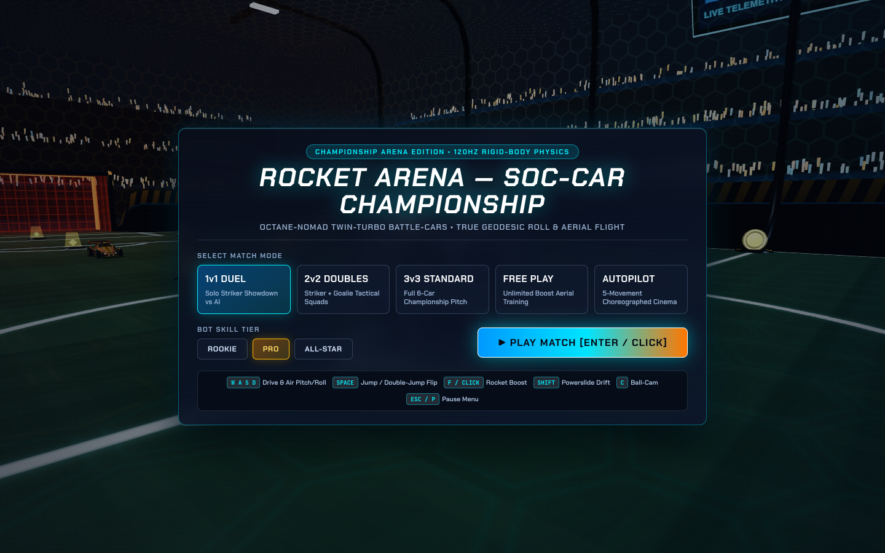
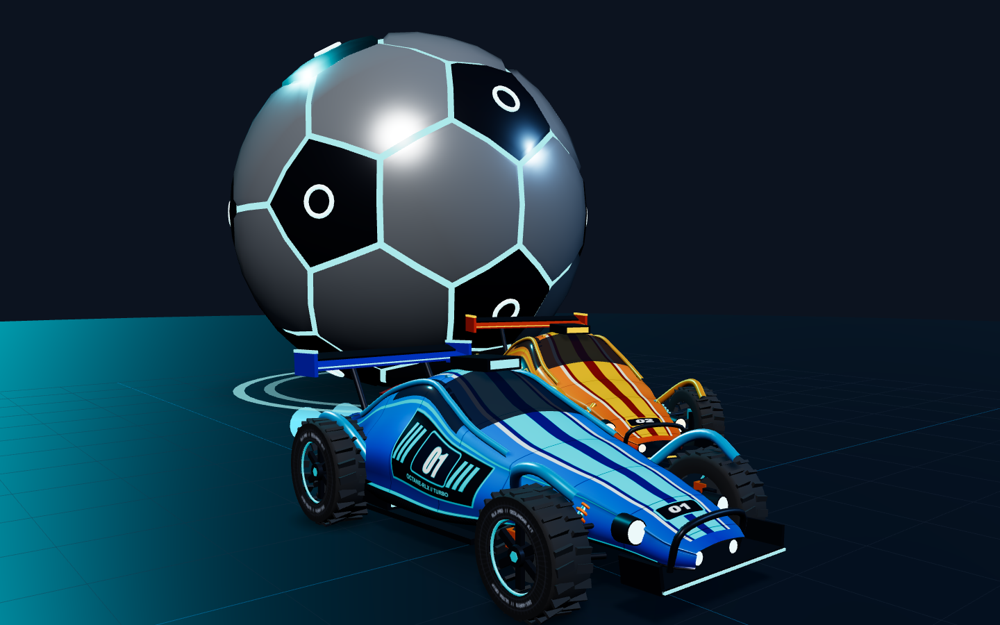
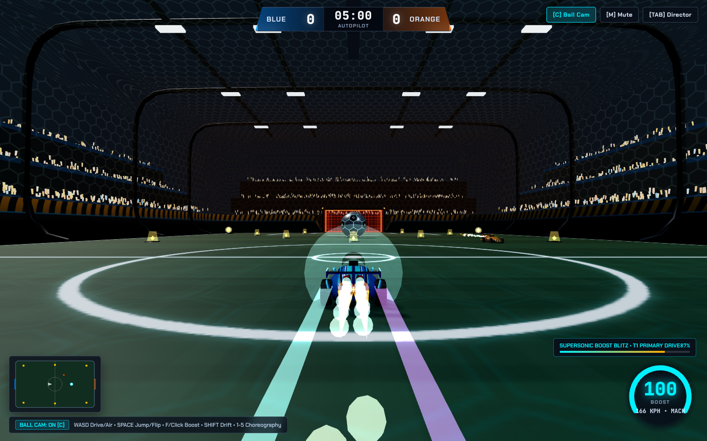

# Single Prompt Rocket League — DFH Neo-Dome & Octane-RLX

A browser-based 3D vehicular soccer game built with Three.js (`0.160.0`) and WebGL2. Play 1v1, 2v2, Free Play, or Autopilot Showcase inside the `DFH Neo-Dome` stadium driving the `Octane-RLX` battle-car.

**Live demo:** [https://oik01.github.io/single-prompt-rocket-league/](https://oik01.github.io/single-prompt-rocket-league/)



| Studio inspection (`front_34`) | Supersonic boost blitz (`action_m1`) |
| --- | --- |
|  |  |

## How to run

The self-contained `index.html` bundles all five source modules and loads Three.js `0.160.0` via a CDN importmap, so it runs without a build server:

1. **Direct file open:** Double-click `index.html` or open it via `file://` in any modern browser.
2. **GitHub Pages:** Open [https://oik01.github.io/single-prompt-rocket-league/](https://oik01.github.io/single-prompt-rocket-league/).
3. **Local HTTP server:**
   ```bash
   python3 -m http.server 8000
   ```
   Then visit `http://localhost:8000`.

If you modify files in `src/`, rebuild `dist/app-bundle.js` and `index.html`:

```bash
python3 scripts/bundle_index.py
```

## Controls

| Input | Action |
| --- | --- |
| `W` `A` `S` `D` / `Arrow Keys` | Throttle, reverse, ground steering, and directional flip input |
| `Space` / `Right-Click` | Jump, double jump, directional dodge flip (or skip instant replay) |
| `F` / `Left-Click` | Rocket boost |
| `Shift` | Powerslide on ground; air-roll modifier in flight |
| `I` `K` / `Q` `E` | Explicit aerial pitch (`I`/`K`) and roll (`Q`/`E`) |
| `C` | Toggle camera between Ball-Cam and Car-Cam |
| `Esc` / `P` | Open/close pause menu (resume, restart, switch mode, or return to main menu) |
| `Tab` | Toggle the Director and Mutator drawer |
| `1` - `5` | Trigger choreographed 4-phase movements (`M1` Boost Blitz to `M5` Goal Explosion) |
| `0` | Start AI vs. AI autopilot showcase |
| `R` | Reset kickoff |
| `M` | Mute/unmute Web Audio synthesizer |

## Architecture

- [`src/arena-and-environment.js`](src/arena-and-environment.js): Constructs the `DFH Neo-Dome` stadium (102.4m x 82.0m x 20.0m interior volume, 8.0m wall-to-floor and wall-to-ceiling curve fillets, recessed blue and orange goal boxes, and 34 boost pads), procedural turf and hex-glass textures, and the analytic signed distance field (`evalArenaSDF`) used for continuous surface collisions.
- [`src/vehicles-and-ball.js`](src/vehicles-and-ball.js): Generates the `Octane-RLX` chassis via 9-station longitudinal cross-section lofting, procedural `2048x1024` bilateral UV livery textures, twin exhaust nozzles, 4-wheel double-wishbone suspension assemblies, and the geodesic soccer ball mesh with proximity-pulsing seams.
- [`src/physics-and-kinematics.js`](src/physics-and-kinematics.js): Runs a fixed `120 Hz` semi-implicit Euler physics solver with 4-raycast suspension, lateral tire slip curves, arbitrary surface normal adherence for driving up curved walls and across the ceiling, ball-car impulse resolution with Magnus spin curve, bot AI (`Rookie`, `Pro`, `All-Star`), and five deterministic 4-phase ($t_0 \dots t_3$) movement choreographies.
- [`src/vfx-audio-and-ui.js`](src/vfx-audio-and-ui.js): Implements the spring-arm `CameraDirector` (Ball-Cam and Car-Cam slerp, speed-reactive FOV ramp), GPU-instanced particle systems (boost plumes, drift sparks, supersonic shock cones, 800-particle goal explosions), procedural Web Audio engine and impact foley, a 300-frame instant replay ring buffer, and the HUD/menu overlays.
- [`src/main.js`](src/main.js): Connects the WebGL2 renderer, fixed-timestep simulation loop, hardware input bindings, 6-angle studio inspection rig, and runtime telemetry (`window.__RL_GAME__`, `window.__SIM_STATE__`, `window.__MOTION_TELEMETRY__`).
- [`scripts/bundle_index.py`](scripts/bundle_index.py): Packages `src/*.js` into `dist/app-bundle.js` and embeds the bundle into `index.html`.
